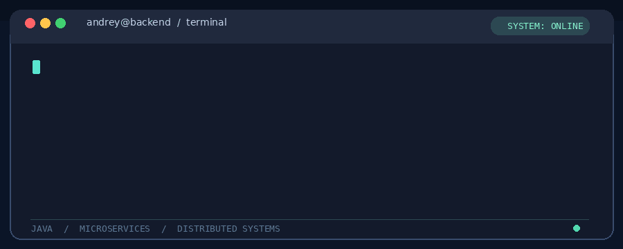

# Hey, I'm Andrey 👋

### Senior Java Backend Engineer · Building things that survive production

*Turning coffee into distributed systems, one deployment at a time.*

## 🧑‍💻 A little about me

I'm a backend engineer who enjoys designing **reliable services**, solving tricky production problems, and making distributed systems behave (most of the time).

- ⚙️ **Daily drivers:** Java, Kotlin, Spring Boot, and microservices.
- 🧠 **Interested in:** distributed systems, performance, architecture, and observability.
- ☁️ **Comfort zone:** containers, Kubernetes, cloud infrastructure, and CI/CD.
- 🤖 **Currently exploring:** AI-assisted development and developer tooling.
- ☕ **Engineering philosophy:** *If it works only on my machine, it's not done yet.*

## 🛠️ My toolbox

**Languages & backend**

**Data & messaging**

**Infrastructure & observability**

## 🚀 Open-source corner

**[kinopoisk-api](https://github.com/TrueDevProfile/kinopoisk-api)** — a Java/Kotlin library for working with Kinopoisk data. A little bit of open source, a little bit of cinema. 🎬

## 📊 GitHub activity

---

**`while (alive) { learn(); build(); improve(); }`**

*Thanks for stopping by. May your builds be green and your alerts be quiet.* 🟢

